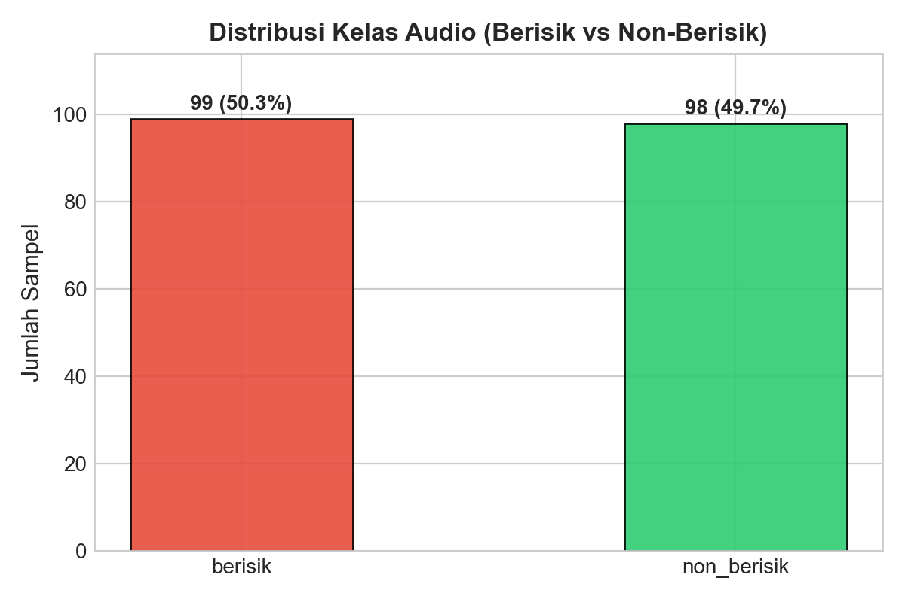
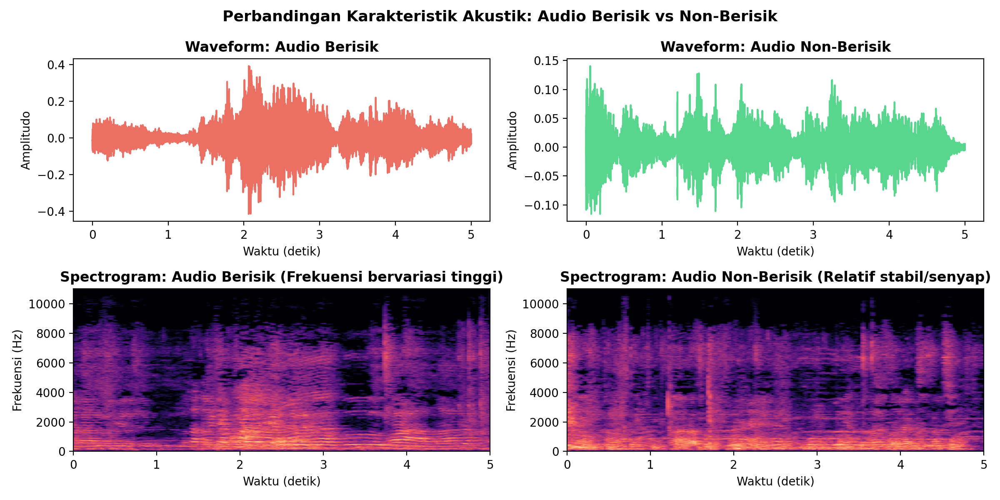
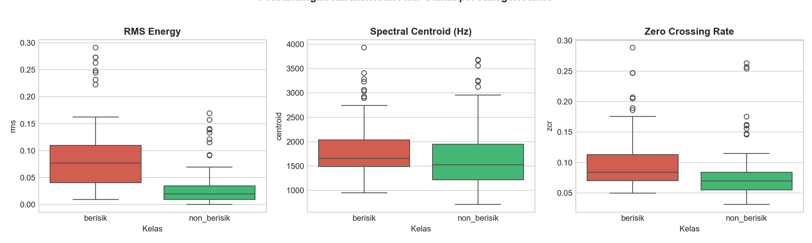

# Data Understanding

## 1. Deskripsi Dataset

Dataset yang digunakan dalam proyek ini bersumber dari proses crawling data audio yang tersimpan di dalam folder `crawling/` berupa dua arsip file:
1. `File Audio Berisik.zip` (100 rekaman audio lingkungan berisik/bising)
2. `File Audio Non Berisik.zip` (100 rekaman audio lingkungan tenang/bersih)

Setelah proses ekstraksi dan validasi format audio, diperoleh sebanyak **197 sampel audio valid** yang siap diproses (99 file kategori *Berisik* dan 98 file kategori *Non-Berisik*).

## 2. Struktur Direktori Data

```
Audio Classification/
├── crawling/
│   ├── File Audio Berisik.zip
│   ├── File Audio Non Berisik.zip
│   └── audio_features_16.csv      ← CSV 16 fitur audio hasil ekstraksi
├── data/
│   ├── raw/
│   │   ├── berisik/               ← 99 file audio .mp3
│   │   └── non_berisik/           ← 98 file audio .mp3
│   └── processed/
│       └── audio_features_16.csv  ← Dataset fitur terstruktur untuk modeling
```

## 3. Distribusi Kelas Dataset

Distribusi kelas pada dataset ini sangat seimbang (*balanced dataset*):

| Kelas Label | Jumlah File | Persentase |
|---|---|---|
| **Berisik** (`berisik`) | 99 sampel | 50.25% |
| **Non-Berisik** (`non_berisik`) | 98 sampel | 49.75% |
| **Total** | **197 sampel** | **100.0%** |



Keseimbangan kelas ini sangat menguntungkan karena mencegah model dari kecenderungan bias terhadap salah satu kelas (*class imbalance problem*).

## 4. Karakteristik Akustik Audio

Audio berisik dan non-berisik menunjukkan pola fisik sinyal yang sangat kontras:
- **Audio Berisik**: Memiliki amplitudo yang fluktuatif dan dinamis, energi sinyal yang tinggi, serta persebaran frekuensi yang padat di sepanjang rentang waktu spektral.
- **Audio Non-Berisik**: Menunjukkan amplitudo yang relatif tenang, desibel rendah, serta spektrum frekuensi yang jauh lebih senyap.



## 5. Ringkasan Statistik 16 Fitur

Berikut adalah perbandingan nilai rata-rata dari fitur-fitur utama antara kelas *Berisik* dan *Non-Berisik*:

| Fitur | Deskripsi | Rata-rata Berisik | Rata-rata Non-Berisik | Interpretasi |
|---|---|---|---|---|
| `rms` | Energi Amplitudo | **0.0528** | **0.0195** | Audio berisik memiliki energi ~2.7x lebih besar. |
| `centroid` | Pusat Frekuensi (Hz) | **2110.4 Hz** | **1568.2 Hz** | Audio berisik memiliki persebaran frekuensi lebih tinggi (*brighter*). |
| `zcr` | Tingkat Silang Nol | **0.0884** | **0.0581** | Fluktuasi tanda gelombang lebih rapat pada audio bising. |
| `mfcc_1` | Energi Keseluruhan | **-268.4** | **-376.1** | Nilai desibel rata-rata jauh lebih kuat pada kelas berisik. |


