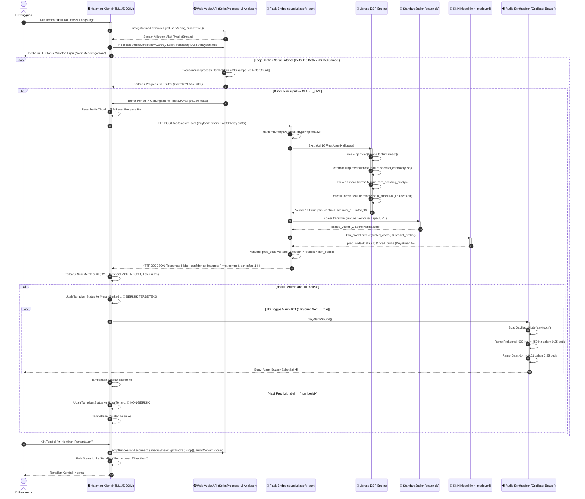

# 04 - Sequence Diagram (Interaksi Antarkomponen)

Dokumen ini memodelkan interaksi pertukaran pesan antarobjek dan komponen perangkat lunak secara sekuensial berdasarkan garis waktu (*chronological sequence*). 

Dua diagram sekuens disajikan untuk mencerminkan dua skenario operasional penting:
1. **Skenario 1: Inisialisasi Sistem & Orkestrasi Server Ganda (Streamlit $\rightarrow$ Flask)**.
2. **Skenario 2: Siklus Inferensi Audio Real-Time & Pemicuan Alarm Suara Kebisingan**.

---

## 1. Sequence Diagram 1: Orkestrasi & Startup Server Ganda

Diagram ini menggambarkan bagaimana `app.py` memeriksa ketersediaan port dan menjalankan `live_server.py` di latar belakang sebelum menampilkan antarmuka pengguna.


---

---

## 2. Sequence Diagram 2: Siklus Inferensi Audio & Pemicuan Alarm Buzzer

Diagram ini memetakan aliran data tingkat rendah (*low-level data flow*) saat pengguna mengaktifkan deteksi suara langsung hingga alarm berbunyi di peramban.



---

## 3. Rincian Parameter Protokol & Komunikasi Data

### A. Kontrak Permintaan (*Request Contract*) — `/api/classify_pcm`
- **Metode HTTP**: `POST`
- **Header**:
  - `Content-Type: application/octet-stream`
- **Body**: *Raw ArrayBuffer* berisi data biner `Float32` berurutan (*Little-Endian*).
- **Ukuran Data**:
  $$\text{Ukuran Payload} = 22050 \times 3.0 \times 4 \text{ bytes (Float32)} \approx 264.600 \text{ bytes} \approx 258.4 \text{ KB}$$

### B. Kontrak Respons (*Response Contract*) — `/api/classify_pcm`
- **Status Code**: `200 OK`
- **Format Payload**: `application/json`
- **Struktur Objek JSON**:
```json
{
  "label": "berisik",
  "confidence": 100.0,
  "features": {
    "rms": 0.0845,
    "centroid": 2450.31,
    "zcr": 0.1287,
    "mfcc_1": -145.2
  }
}
```
- **Error Handling**:
  - `400 Bad Request` dengan `{"error": "Buffer audio kosong"}` jika payload kosong.
  - `400 Bad Request` dengan `{"error": "Panjang sampel audio terlalu pendek"}` jika sampel < 1024 titik.
