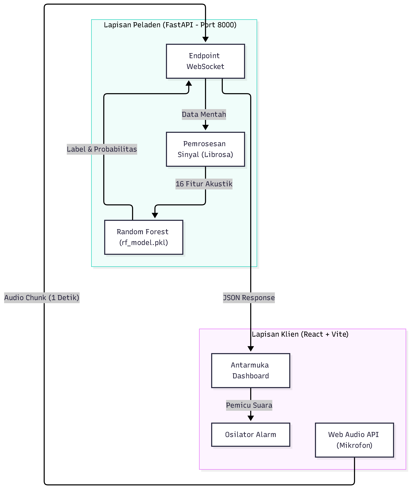
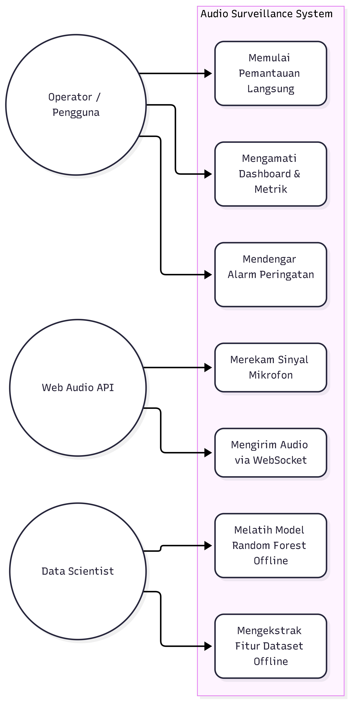
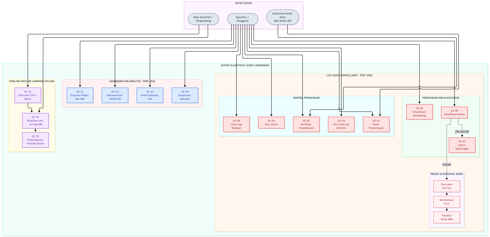
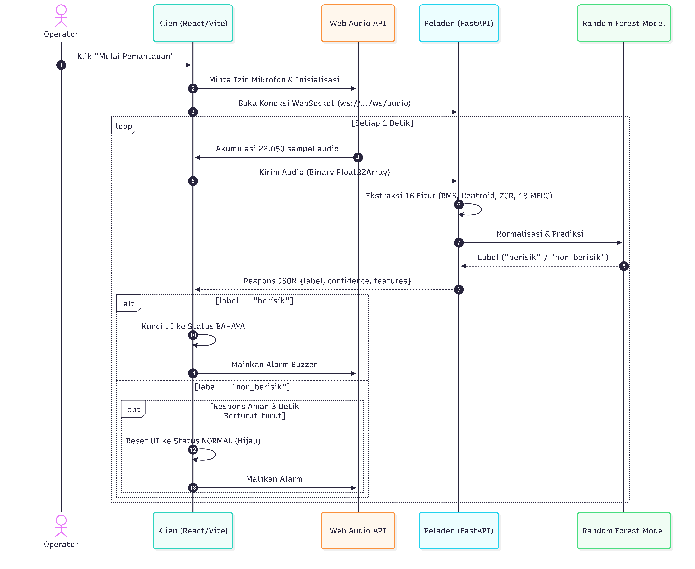
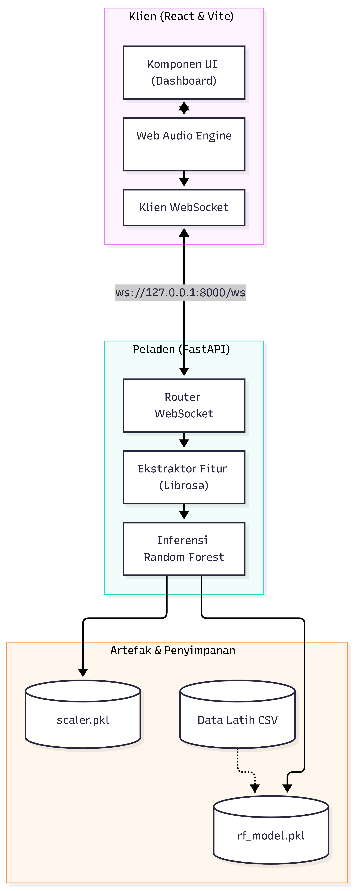
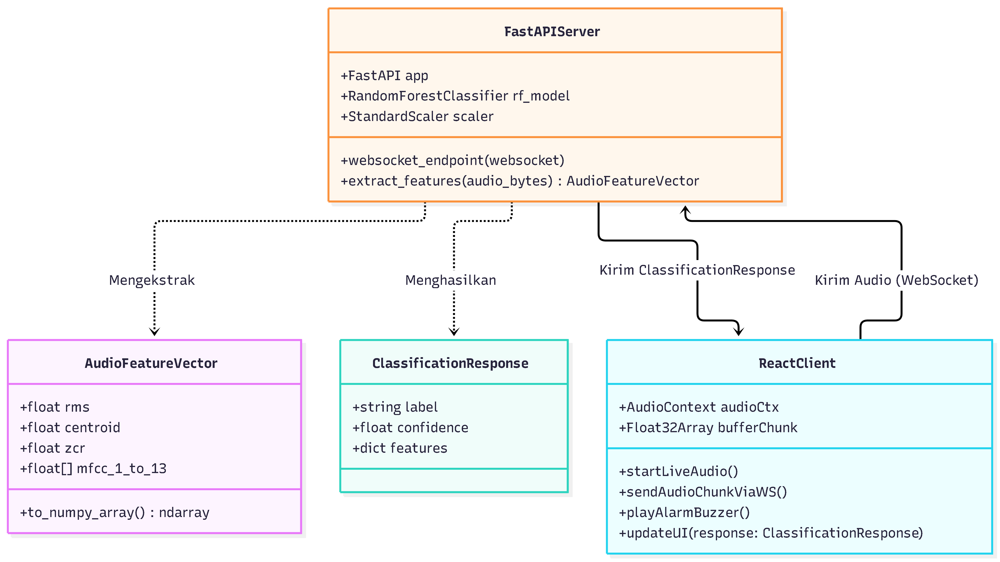

# Business Understanding

## 1. Latar Belakang

Kebisingan lingkungan (*environmental noise*) merupakan salah satu faktor yang dapat mengganggu kenyamanan, konsentrasi, komunikasi, serta kualitas lingkungan di berbagai area, seperti ruang publik, perkantoran, fasilitas pendidikan, dan kawasan industri. Pemantauan kebisingan secara konvensional yang mengandalkan pengamatan manusia membutuhkan perhatian secara terus-menerus dan berpotensi mengalami keterlambatan dalam mengenali kondisi suara yang mengganggu.

Perkembangan teknologi Pemrosesan Sinyal Digital (*Digital Signal Processing*) dan *Machine Learning* memungkinkan proses pengenalan karakteristik suara dilakukan secara otomatis. Melalui pendekatan tersebut, sistem dapat memanfaatkan sinyal audio sebagai data masukan, mengekstrak karakteristik akustik, dan mengklasifikasikan kondisi lingkungan berdasarkan pola yang dipelajari oleh model.

Proyek **Audio Surveillance System** dikembangkan sebagai sistem pemantauan suara secara waktu nyata (*real-time*). Sistem menggunakan mikrofon pada peramban untuk menangkap suara lingkungan, kemudian mengirimkan data audio ke server untuk dianalisis. Server mengekstrak fitur akustik dan menggunakan model *Random Forest* untuk mengklasifikasikan suara ke dalam dua kategori, yaitu **Berisik** dan **Non-Berisik**.

Hasil klasifikasi dikirimkan kembali ke antarmuka pengguna untuk ditampilkan dalam bentuk indikator status, metrik akustik, visualisasi gelombang suara (*waveform*), dan log aktivitas deteksi. Ketika kondisi berisik terdeteksi, sistem juga dirancang untuk memberikan peringatan suara kepada pengguna.

Dengan mengintegrasikan pengolahan audio, pembelajaran mesin, komunikasi WebSocket, dan dashboard interaktif, sistem ini diharapkan dapat membantu pengguna mengenali kondisi kebisingan lingkungan secara lebih cepat dan praktis.

## 2. Rumusan Masalah

1. Bagaimana menangkap dan mengirimkan data audio dari mikrofon peramban ke server secara berkelanjutan?
2. Bagaimana mengekstrak 16 fitur akustik yang terdiri atas RMS, Spectral Centroid, Zero Crossing Rate, dan 13 koefisien MFCC secara konsisten?
3. Bagaimana memanfaatkan model *Machine Learning* berbasis Random Forest untuk mengklasifikasikan suara ke dalam kategori Berisik dan Non-Berisik?
4. Bagaimana mengintegrasikan proses pengambilan audio, ekstraksi fitur, inferensi model, dan pengiriman hasil klasifikasi dalam sistem pemantauan waktu nyata?
5. Bagaimana menyajikan hasil pemantauan melalui dashboard yang informatif, termasuk status deteksi, metrik akustik, visualisasi gelombang audio, log aktivitas, dan peringatan suara yang stabil?

## 3. Tujuan Proyek

- **Pengambilan dan Transmisi Audio:** Mengambil audio lingkungan melalui mikrofon peramban dan mengirimkan potongan data audio ke server menggunakan WebSocket.
- **Ekstraksi Fitur Akustik:** Menghasilkan 16 fitur numerik yang terdiri atas RMS, Spectral Centroid, Zero Crossing Rate, dan 13 koefisien MFCC.
- **Pengembangan Model:** Menggunakan model klasifikasi Random Forest untuk membedakan kondisi suara Berisik dan Non-Berisik.
- **Validasi Kinerja:** Mengevaluasi kemampuan klasifikasi menggunakan metrik Accuracy, Precision, Recall, F1-Score, dan Confusion Matrix.
- **Pengembangan Dashboard:** Menyediakan antarmuka yang menampilkan status sistem, indikator hasil deteksi, metrik akustik, visualisasi gelombang audio, dan log aktivitas.
- **Integrasi Sistem:** Menghubungkan frontend dan backend melalui WebSocket agar data audio dapat diproses dan hasil prediksi dapat dikirimkan kembali tanpa harus melakukan permintaan HTTP berulang.
- **Peringatan Kebisingan:** Menyediakan mekanisme peringatan suara ketika sistem mendeteksi kondisi Berisik dengan kontrol stabilitas (*cooldown*).

## 4. Gambaran Umum dan Cara Kerja Sistem

Audio Surveillance System menggunakan arsitektur *client-server* yang memisahkan antarmuka pengguna dari proses pengolahan audio dan klasifikasi. Frontend bertanggung jawab terhadap pengambilan audio dari mikrofon dan penyajian informasi kepada pengguna, sedangkan backend bertanggung jawab terhadap ekstraksi fitur dan inferensi model.

Alur kerja sistem adalah sebagai berikut:

1. **Inisialisasi pemantauan:** Pengguna membuka dashboard dan menekan tombol untuk memulai pemantauan suara.
2. **Pengambilan audio:** Peramban meminta izin akses mikrofon dan mengambil sinyal audio menggunakan Web Audio API.
3. **Pembagian data audio:** Audio dikumpulkan menjadi potongan data (*audio chunks*) untuk dikirimkan ke server. Sistem dirancang menggunakan jendela audio 1 detik (berbasis akumulasi sampel referensi) untuk pengiriman instan.
4. **Transmisi data:** Frontend mengirimkan data audio ke backend melalui koneksi WebSocket.
5. **Pemrosesan audio:** Backend mengubah data audio yang diterima menjadi representasi numerik dan melakukan ekstraksi fitur akustik.
6. **Klasifikasi:** Fitur audio diproses menggunakan scaler dan model Random Forest yang telah disiapkan untuk menghasilkan prediksi kelas.
7. **Pengiriman hasil:** Backend mengirimkan hasil prediksi dan informasi fitur yang diperlukan kembali ke frontend dalam format JSON.
8. **Penyajian hasil:** Dashboard memperbarui status deteksi, nilai metrik, visualisasi gelombang audio, dan log aktivitas berdasarkan data yang diterima.
9. **Peringatan & Stabilisasi (Cooldown):** Apabila hasil klasifikasi menunjukkan kondisi Berisik, frontend langsung mengunci status bahaya (*state latching*) dan memicu peringatan suara. Status alarm dan UI baru akan direset ke kondisi normal (Non-Berisik) hanya jika server mengirimkan validasi status aman selama 3 detik berturut-turut. Hal ini mencegah peringatan mati-nyala (*flickering*) saat suara sedikit bergelombang.

Alur tersebut berlangsung berulang selama pemantauan aktif. Keberhasilan proses secara menyeluruh bergantung pada koneksi WebSocket, akses mikrofon, kesesuaian format data audio, dan ketersediaan model pada backend.

## 5. Teknologi, Framework, dan Library

Teknologi yang digunakan dibagi menjadi dua bagian utama, yaitu frontend dan backend.

### 5.1 Frontend

Frontend merupakan bagian sistem yang berinteraksi langsung dengan pengguna. Antarmuka dibangun menggunakan teknologi web untuk menampilkan informasi hasil pemantauan secara dinamis.

| Teknologi | Fungsi |
|---|---|
| React | Membangun antarmuka pengguna berbasis komponen, seperti header, kartu status, kartu metrik, visualisasi audio, dan log deteksi. |
| TypeScript | Menambahkan sistem tipe pada kode JavaScript agar struktur data dan properti komponen lebih terkontrol. |
| Vite | Menyediakan server pengembangan frontend dan proses pembangunan aplikasi. |
| Web Audio API | Mengakses mikrofon melalui peramban serta memproses aliran audio di sisi klien. |
| WebSocket API | Membuat koneksi komunikasi dua arah antara frontend dan backend untuk pengiriman audio dan penerimaan hasil prediksi. |
| HTML dan CSS | Menyusun struktur halaman serta mengatur tampilan dashboard, warna, tata letak, responsivitas, dan komponen visual. |
| Canvas API | Menggambar visualisasi gelombang suara pada elemen canvas di dashboard. |

### 5.2 Backend

Backend bertanggung jawab untuk menerima data audio, melakukan pengolahan sinyal, dan menjalankan model klasifikasi.

| Teknologi/Library | Fungsi |
|---|---|
| Python | Bahasa pemrograman utama untuk pemrosesan audio dan inferensi model. |
| FastAPI | Framework backend untuk menyediakan layanan API dan endpoint WebSocket. |
| NumPy | Mengolah data audio dalam bentuk array numerik. |
| Librosa | Mengekstrak fitur audio, termasuk RMS, Spectral Centroid, Zero Crossing Rate, dan MFCC. |
| scikit-learn | Menyediakan komponen pemrosesan data dan model klasifikasi Random Forest. |
| Joblib/Pickle | Memuat artefak model yang telah disimpan, sesuai metode penyimpanan yang digunakan pada proyek. |
| Uvicorn | Server ASGI yang digunakan untuk menjalankan aplikasi FastAPI. |

**Catatan:** Tabel ini menjelaskan teknologi yang digunakan atau direncanakan berdasarkan rancangan sistem. Nama dan penggunaan library backend, termasuk Joblib/Pickle dan Uvicorn, perlu diverifikasi dengan kode backend serta berkas dependensi proyek.

### 5.3 Model dan Artefak Machine Learning

Sistem menggunakan model Random Forest untuk melakukan klasifikasi suara menjadi Berisik atau Non-Berisik. Model dan komponen pendukungnya disimpan sebagai artefak agar dapat dimuat kembali ketika backend dijalankan.

Artefak model yang terdapat dalam rancangan proyek meliputi:

- `rf_model.pkl`: model Random Forest yang digunakan untuk memprediksi kelas suara.
- `scaler.pkl`: objek normalisasi atau penskalaan fitur, jika digunakan pada proses pelatihan model.
- `label_encoder.pkl`: objek pemetaan kelas numerik ke label kategori, jika digunakan dalam pipeline model.
- `model_metadata.json`: berkas metadata model, jika digunakan oleh implementasi backend.

Penggunaan scaler dan label encoder saat inferensi harus mengikuti pipeline pelatihan agar fitur yang diberikan kepada model memiliki urutan, skala, dan pemetaan kelas yang sesuai.

## 6. Manfaat

| Aspek | Manfaat Konkret |
|---|---|
| Otomatisasi Pemantauan | Membantu pengguna memantau dan mengklasifikasikan kondisi suara lingkungan secara otomatis. |
| Dukungan Pengambilan Keputusan | Memberikan informasi mengenai kondisi kebisingan sebagai bahan pertimbangan pengguna. |
| Peringatan Dini | Memberikan peringatan suara secara instan dengan toleransi peredaman cerdas saat mendeteksi kondisi Berisik. |
| Visualisasi Informasi | Menyajikan status deteksi, fitur akustik, gelombang audio, dan riwayat deteksi melalui satu dashboard. |
| Integrasi Teknologi | Menggabungkan pemrosesan sinyal digital, Machine Learning, komunikasi WebSocket, dan antarmuka web. |
| Akademis dan Sains Data | Menjadi implementasi praktis penerapan metodologi CRISP-DM pada proyek klasifikasi audio. |

## 7. Batasan Masalah

1. Sistem mengklasifikasikan audio ke dalam dua kategori, yaitu Berisik dan Non-Berisik.
2. Fitur akustik yang dirancang terdiri atas 16 atribut: RMS, Spectral Centroid, Zero Crossing Rate, dan 13 koefisien MFCC.
3. Model klasifikasi yang digunakan adalah Random Forest.
4. Audio pemantauan langsung diambil melalui mikrofon peramban menggunakan Web Audio API.
5. Audio dikirimkan dari frontend ke backend menggunakan WebSocket, dengan rancangan jendela pengiriman kontinu setiap 1 detik.
6. Backend menggunakan Python dan FastAPI, sedangkan frontend menggunakan React, TypeScript, dan Vite.
7. Dashboard menampilkan informasi hasil klasifikasi dan fitur akustik yang dikirimkan oleh backend.
8. Sistem tidak mencakup autentikasi pengguna atau penyimpanan data pada basis data.
9. Kinerja sistem bergantung pada kualitas audio, kondisi mikrofon, koneksi antara frontend dan backend, serta performa model klasifikasi.
10. Kategori Berisik dan Non-Berisik ditentukan berdasarkan data dan model yang digunakan, sehingga tidak secara otomatis menunjukkan bahwa suara telah melampaui ambang batas kebisingan resmi.

## 8. Kriteria Keberhasilan

Proyek dinilai berhasil apabila memenuhi kriteria berikut:

1. Dashboard dapat dibuka dan menampilkan komponen antarmuka dengan baik.
2. Sistem dapat meminta izin mikrofon dan mengambil audio dari peramban.
3. Frontend dapat mengirimkan potongan audio ke backend setiap detik secara stabil melalui WebSocket.
4. Backend dapat memproses audio, mengekstrak fitur yang sesuai, dan menghasilkan prediksi menggunakan model Random Forest.
5. Hasil prediksi dapat diterima frontend dan ditampilkan pada indikator status serta log aktivitas.
6. Nilai metrik akustik dapat ditampilkan ketika data fitur tersedia.
7. Peringatan suara dapat dipicu saat sistem mendeteksi kondisi Berisik.
8. Sistem mampu menahan status peringatan secara stabil dan baru mereset UI ke kondisi normal setelah menerima respons Non-Berisik selama 3 detik berturut-turut.
9. Kinerja klasifikasi dapat dievaluasi menggunakan Accuracy, Precision, Recall, F1-Score, dan Confusion Matrix.

## 9. Desain Sistem

Bagian ini memodelkan arsitektur, interaksi, dan alur kerja dari sistem Audio Surveillance menggunakan pendekatan komponen klien (React) dan peladen (FastAPI).

### 9.1 Arsitektur Sistem (System Architecture)
Sistem dirancang menggunakan arsitektur *Client-Server* berbasis *WebSocket* untuk menjamin latensi yang sangat rendah dalam transmisi audio berkelanjutan.
* **Lapisan Klien (React + Web Audio API):** Mengambil sampel audio 22.050 Hz, mengemasnya setiap 1 detik (22.050 sampel), dan mengurus perenderan antarmuka (gelombang suara, metrik, alarm) secara *real-time*.
* **Lapisan Peladen (FastAPI + Librosa):** Menerima aliran biner audio, mengekstrak 16 fitur akustik, dan menggunakan model Random Forest (`rf_model.pkl`) untuk inferensi kelas suara.

### 9.2 Kasus Penggunaan (Use Case)
Sistem berinteraksi dengan dua aktor utama dan satu aktor sistem:
1. **Operator Lingkungan:** Mengaktifkan mikrofon, memantau *dashboard*, dan menerima peringatan alarm.
2. **Pengembang (Data Scientist):** Melatih model Random Forest secara *offline* dan memelihara *pipeline* ekstraksi fitur.
3. **Web Audio API (Sistem Klien):** Bertugas merekam sinyal mikrofon, memecah *buffer* per 1 detik, dan memicu sintesis suara alarm.

### 9.3 Alur Proses (Activity Diagram)
Aktivitas sistem terbagi menjadi dua alur utama:
* **Pipeline Offline:** Ekstraksi fitur CSV dari dataset mentah $\rightarrow$ Pelatihan Model Random Forest $\rightarrow$ Ekspor *Scaler* dan Model.
* **Pipeline Online:** 
  1. Klien mengirim *chunk* audio via WebSocket setiap 1 detik.
  2. Peladen merespons dengan hasil fitur dan probabilitas kelas.
  3. UI merespons hasil: Jika berisik, alarm langsung menyala (dikunci). Jika non-berisik 3 detik berturut-turut, status kembali hijau (mekanisme *cooldown*).

### 9.4 Interaksi Antarkomponen (Sequence Diagram)
Siklus inferensi audio *real-time* terjadi dalam putaran transmisi WebSocket tanpa beban *overhead* HTTP:
1. `App.tsx` membuka jalur `ws://127.0.0.1:8000/ws/audio`.
2. Klien mengirim `Float32Array.buffer` (durasi 1 detik).
3. FastAPI memproses dengan `librosa` untuk mendapat 16 vektor fitur (RMS, Centroid, ZCR, 13 MFCC).
4. `StandardScaler` menormalkan vektor, lalu `RandomForestClassifier` memprediksi label.
5. FastAPI mengirim JSON `{"label": "...", "confidence": ..., "features": {...}}`.
6. React memperbarui DOM dan membunyikan fungsi `playAlarm()` jika label berisik.

### 9.5 Struktur Kelas & Komponen
Sistem bertumpu pada pertukaran objek fitur akustik (*AudioFeatureVector*) yang memiliki 16 dimensi absolut. Objek ini ditransformasikan dari representasi domain-waktu menjadi domain-frekuensi di peladen, kemudian dikembalikan ke antarmuka React untuk divisualisasikan pada kartu metrik.

*Diagram Komponen:*

*Diagram Struktur Kelas:*

## 10. Demo Aplikasi Interaktif

