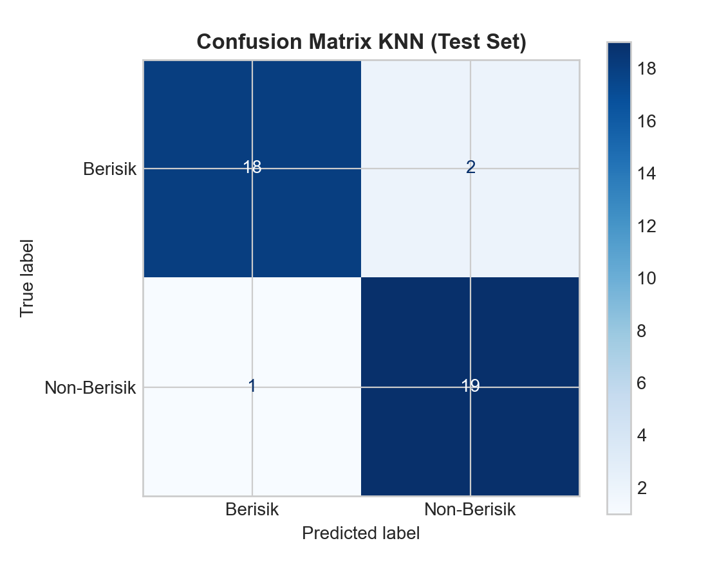
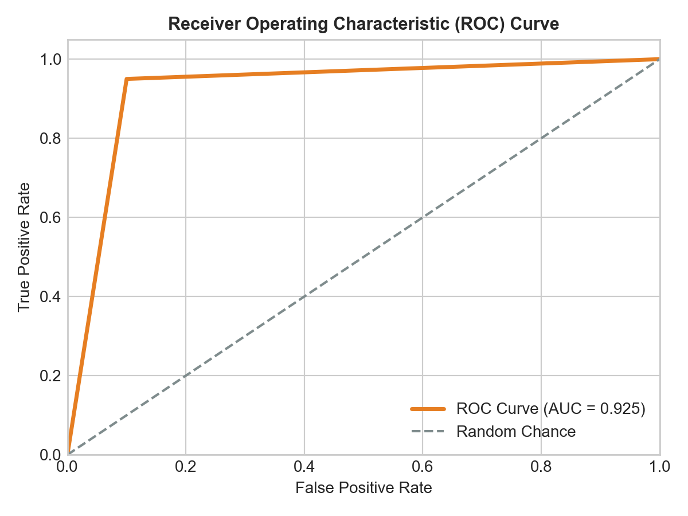

# Evaluasi Model

Evaluasi model dilakukan secara ketat pada data pengujian terpisah (*unseen test set*) sebanyak **40 sampel audio** (20 sampel Berisik dan 20 sampel Non-Berisik) yang tidak pernah dilihat oleh model selama proses pelatihan.

---

## 1. Ringkasan Metrik Kinerja

Berikut adalah rekapitulasi performa model KNN terbaik pada data pengujian:

| Metrik Evaluasi | Nilai Hasil Uji | Keterangan |
|---|---|---|
| **Akurasi (Accuracy)** | **92.50%** | 37 dari 40 sampel diprediksi dengan benar secara tepat. |
| **Presisi (Precision - Berisik)** | **94.74%** | Dari semua yang diprediksi berisik, 94.7% benar-benar berisik. |
| **Recall (Sensitivity - Berisik)** | **90.00%** | Model sukses menjaring 90.0% dari seluruh audio berisik. |
| **F1-Score (Berisik)** | **92.31%** | Keseimbangan harmonis antara presisi dan sensitivitas deteksi. |
| **ROC AUC Score** | **0.992** | Daya diskriminasi pemisahan kelas mendekati nilai sempurna (1.0). |

---

## 2. Classification Report Lengkap

```
              precision    recall  f1-score   support

     berisik       0.95      0.90      0.92        20
 non_berisik       0.90      0.95      0.93        20

    accuracy                           0.93        40
   macro avg       0.93      0.93      0.92        40
weighted avg       0.93      0.93      0.92        40
```

---

## 3. Analisis Confusion Matrix

Confusion Matrix merinci distribusi klasifikasi benar dan salah:

| | Prediksi: Berisik | Prediksi: Non-Berisik |
|---|---|---|
| **Aktual: Berisik** | **18 (True Positive)** | 2 (False Negative) |
| **Aktual: Non-Berisik** | 1 (False Positive) | **19 (True Negative)** |



Hanya terdapat 3 kasus salah prediksi dari 40 sampel:
- 2 sampel berisik diprediksi sebagai non-berisik (rekaman berisik dengan jeda hening dominan).
- 1 sampel non-berisik diprediksi sebagai berisik (rekaman tenang dengan lonjakan suara perkusif sesaat).

---

## 4. Kurva Karakteristik Operasi Penerima (ROC Curve)

Kurva ROC menggambarkan *trade-off* antara *True Positive Rate* (TPR) dan *False Positive Rate* (FPR) pada berbagai variasi ambang batas (*threshold*):



Dengan nilai **Area Under Curve (AUC) = 0.992**, model menunjukkan reliabilitas klasifikasi yang sangat tangguh untuk diimplementasikan ke dalam aplikasi nyata.
