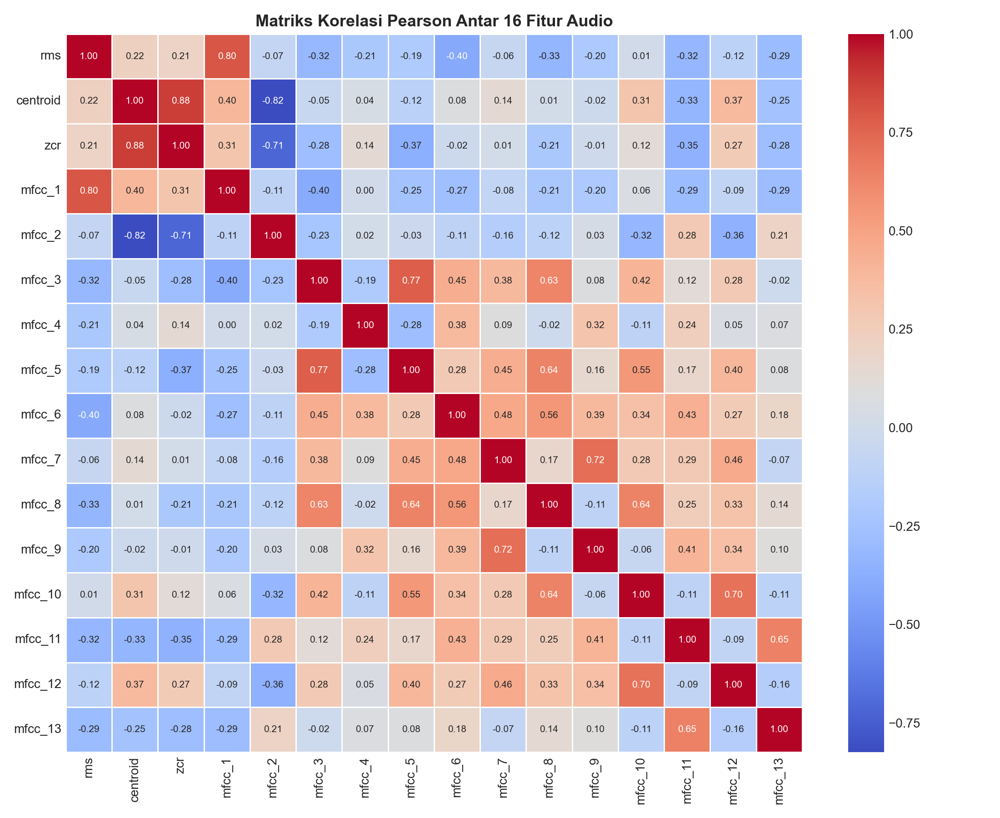

# Feature Extraction (Ekstraksi 16 Fitur Audio)

## 1. Konsep Dasar Ekstraksi Fitur Audio

Ekstraksi fitur audio adalah proses mengonversi sinyal gelombang suara satu dimensi yang berfluktuasi terhadap waktu menjadi sekumpulan representasi numerik ringkas yang mencerminkan karakteristik fisik dan perseptual sinyal.

Sesuai instruksi proyek, fitur yang diekstrak berjumlah tepat **16 kolom fitur**, yaitu:
1. **RMS (Root Mean Square)** (1 fitur)
2. **Spectral Centroid** (1 fitur)
3. **ZCR (Zero Crossing Rate)** (1 fitur)
4. **MFCC 13 Koefisien** (`mfcc_1` s/d `mfcc_13`) (13 fitur)

Total: $1 + 1 + 1 + 13 = \mathbf{16\text{ Fitur Akustik}}$.

---

## 2. Penjelasan Matematis Masing-Masing Fitur

### 1. Root Mean Square (RMS) Energy
RMS merepresentasikan rata-rata daya atau energi yang terkandung di dalam sinyal audio pada jendela waktu tertentu.
$$\text{RMS} = \sqrt{\frac{1}{N}\sum_{n=0}^{N-1} |x(n)|^2}$$
- **Relevansi**: Suara berisik umumnya memiliki energi rata-rata yang lebih tinggi secara konsisten dibandingkan suara yang tenang.

```python
rms_mean = np.mean(librosa.feature.rms(y=y))
```

### 2. Spectral Centroid
Spectral Centroid menunjukkan "pusat gravitasi" dari spektrum frekuensi audio. Sering diasosiasikan dengan kesan subjektif mengenai "kecerahan" (*brightness*) suara.
$$\text{Centroid} = \frac{\sum_{k=0}^{K-1} f(k) \cdot S(k)}{\sum_{k=0}^{K-1} S(k)}$$
di mana $S(k)$ adalah magnitudo spektral pada bin frekuensi $f(k)$.
- **Relevansi**: Suara berisik (seperti gesekan mesin atau keramaian) mengandung komponen frekuensi tinggi yang melimpah, sehingga nilai centroidnya cenderung lebih tinggi.

```python
centroid_mean = np.mean(librosa.feature.spectral_centroid(y=y, sr=sr))
```

### 3. Zero Crossing Rate (ZCR)
ZCR mengukur seberapa sering gelombang sinyal berpindah tanda dari positif ke negatif atau sebaliknya dalam suatu interval waktu.
$$\text{ZCR} = \frac{1}{2(N-1)}\sum_{n=1}^{N-1} |\text{sgn}(x(n)) - \text{sgn}(x(n-1))|$$
- **Relevansi**: Sangat sensitif terhadap noise perkusif, desis (*hiss*), dan suara berfrekuensi tinggi.

```python
zcr_mean = np.mean(librosa.feature.zero_crossing_rate(y=y))
```

### 4. Mel-Frequency Cepstral Coefficients (13 Koefisien MFCC)
MFCC merupakan fitur standar paling penting dalam pemrosesan suara modern. MFCC memodelkan karakteristik vokal dan timbre suara manusia dengan memetakan frekuensi Hertz ke dalam skala Mel non-linear:
$$m = 2595 \log_{10}\left(1 + \frac{f}{700}\right)$$

Tahapan komputasi 13 koefisien MFCC:
1. Membagi sinyal ke dalam frame jendela Hamming.
2. Menghitung *Fast Fourier Transform* (FFT) dari tiap frame.
3. Menerapkan filter bank Mel berbentuk segitiga (*Mel triangular filterbank*).
4. Menghitung logaritma dari daya spektrum pada tiap filter Mel.
5. Menjalankan *Discrete Cosine Transform* (DCT) untuk menghasilkan 13 koefisien cepstral utama:
$$c_n = \sum_{m=0}^{M-1} \log(S_m) \cos\left[\frac{\pi n}{M}\left(m + \frac{1}{2}\right)\right], \quad n=1, 2, \dots, 13$$

```python
mfcc = librosa.feature.mfcc(y=y, sr=sr, n_mfcc=13)
mfcc_means = [np.mean(c) for c in mfcc]  # 13 nilai koefisien rata-rata
```

---

## 3. Matriks Korelasi Antar 16 Fitur

Untuk memahami interaksi multivariat antar fitur, matriks korelasi Pearson dihitung pada seluruh 197 data sampel:



Terlihat bahwa fitur `rms`, `centroid`, dan beberapa koefisien `mfcc` memiliki hubungan korelasi yang saling melengkapi dalam mengidentifikasi pola kebisingan.
