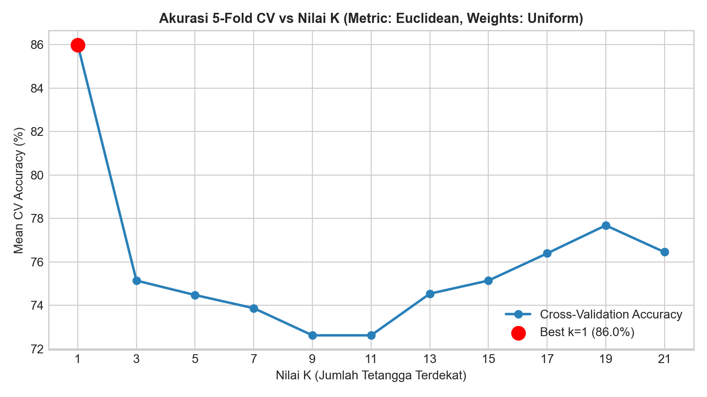

# Modeling (Klasifikasi K-Nearest Neighbors)

## 1. Konsep Algoritma K-Nearest Neighbors (KNN)

*K-Nearest Neighbors* (KNN) adalah algoritma *supervised learning* berbasis instans (*instance-based learning* atau *lazy learning*). Algoritma ini tidak membentuk fungsi parametrik eksplisit selama proses pelatihan, melainkan menyimpan seluruh titik data pelatihan yang telah diskalakan di dalam memori.

Saat ada data uji baru $\mathbf{x}_{\text{baru}}$ dengan 16 dimensi fitur:
1. Menghitung jarak antara $\mathbf{x}_{\text{baru}}$ terhadap seluruh titik data pelatihan $\mathbf{x}_i \in \mathcal{D}_{\text{train}}$.
2. Memilih $k$ tetangga dengan jarak terpendek.
3. Melakukan pemungutan suara terbanyak (*majority voting*) atau pembobotan jarak (*distance weighting*) untuk menentukan prediksi kelas akhir.

---

## 2. Metrik Jarak yang Digunakan

### a. Jarak Euclidean
Jarak garis lurus standar dalam ruang berdimensi 16:
$$d_{\text{Euclidean}}(\mathbf{x}, \mathbf{z}) = \sqrt{\sum_{i=1}^{16} (x_i - z_i)^2}$$

### b. Jarak Manhattan (City Block)
Jumlah selisih nilai absolut di tiap dimensi:
$$d_{\text{Manhattan}}(\mathbf{x}, \mathbf{z}) = \sum_{i=1}^{16} |x_i - z_i|$$

---

## 3. Optimasi Hyperparameter (Grid Search & K-Fold CV)

Untuk menentukan konfigurasi model terbaik, dilakukan pencarian kisi (*GridSearchCV*) dikombinasikan dengan **5-Fold Stratified Cross-Validation** pada data pelatihan (157 sampel):

Ruang parameter yang diuji:
- **Nilai $k$**: Bilangan ganjil antara 1 hingga 21 ($1, 3, 5, 7, \dots, 21$) untuk menghindari hasil suara seimbang (*tie*).
- **Fungsi Bobot (*Weights*)**: `'uniform'` (bobot sama) vs `'distance'` (bobot berbanding terbalik dengan jarak).
- **Metrik Jarak**: `'euclidean'` vs `'manhattan'`.

```python
from sklearn.neighbors import KNeighborsClassifier
from sklearn.model_selection import GridSearchCV, StratifiedKFold

param_grid = {
    'n_neighbors': [1, 3, 5, 7, 9, 11, 13, 15, 17, 19, 21],
    'weights': ['uniform', 'distance'],
    'metric': ['euclidean', 'manhattan']
}

cv = StratifiedKFold(n_splits=5, shuffle=True, random_state=42)
grid_search = GridSearchCV(KNeighborsClassifier(), param_grid, cv=cv, scoring='accuracy')
grid_search.fit(X_train_scaled, y_train)
```

### Hasil Hyperparameter Terbaik

| Parameter | Nilai Terbaik |
|---|---|
| **$k$ (Jumlah Tetangga)** | **1** |
| **Fungsi Bobot** | **Uniform** |
| **Metrik Jarak** | **Euclidean** |
| **Mean CV Accuracy** | **85.99%** |



Hasil tuning menunjukkan bahwa tetangga terdekat terdekat ($k=1$) memberikan batas keputusan (*decision boundary*) yang paling tajam dan representatif pada ruang fitur akustik 16 dimensi yang telah distandarisasi Z-score.
